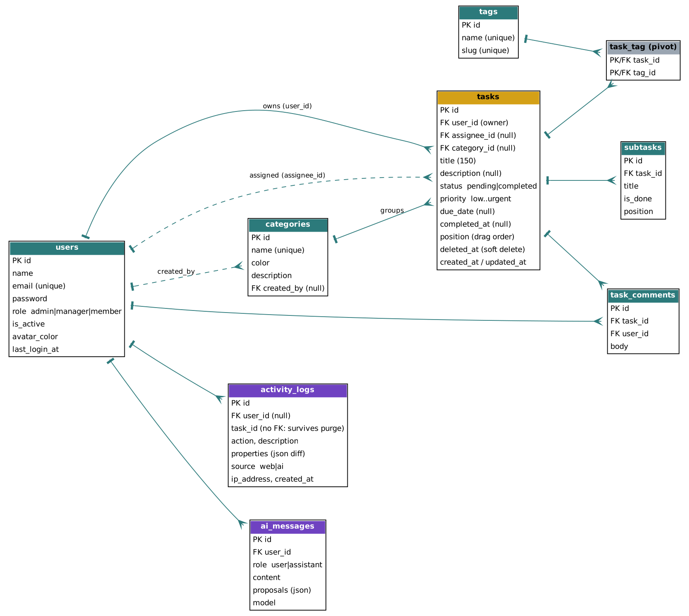

# Task Manager

> ## Reviewer quick start (about 2 minutes)
> Requirements: PHP 8.2+, Composer, MySQL (XAMPP is fine). Create an empty MySQL database named `task_manager`, then:
> ```bash
> composer install
> copy .env.example .env        # macOS/Linux: cp .env.example .env
> php artisan key:generate
> php artisan migrate --seed
> php artisan serve
> ```
> Open http://127.0.0.1:8000 and sign in with `admin@taskmanager.test` / `password` (manager and member accounts are in section 1).
> The **AI assistant is optional**. With no Gemini key the whole app works normally and the assistant answers in offline mode.
> Live demo: **https://tasks.dominium.co.ke/** (the repository is the main submission).

A Laravel 12 + Bootstrap 4 task manager built for the practical test. All required features and all three bonus features are done. I also added role-based access, per-user time zones, an audit trail and an AI assistant. The Scope note below explains why.

| | |
|---|---|
| Framework | Laravel 12 (PHP 8.2+) |
| Frontend | Bootstrap 4.6 (served locally from `public/vendor`, no build step) |
| Database | MySQL (XAMPP) via migrations + Eloquent |
| Auth | Session auth, 3 roles (admin / manager / member) |
| Tests | Feature tests (`php artisan test`) |


## Scope note (read this first)

The brief asks for a simple task manager. I built the required features
first (create, list, edit, delete with a modal, and completed/pending
toggling). Those parts are deliberately small and easy to follow:

    routes/web.php → TaskController → TaskRequest → TaskService → Task model → Blade

Everything after that is a stretch goal I chose to add because it's how I
actually build: role-based security, an audit trail, per-user time zones and
an AI assistant.

The AI is not a gimmick and it's not padding. It's a pattern I use across
most of my projects: instead of making a user learn the whole app, let them
say what they want and act on it directly. Here it can find, create, update,
complete and delete tasks by chat, but every write goes through an editable
confirmation card and the exact same policies and service layer as the web
UI, so it can never do more than the signed-in user could do by hand.

If you only have two minutes: quick start above, then open the AI panel and
type "show overdue" or "add task Review notes due tomorrow priority high".

---


## 1. Quick start on XAMPP (Windows)

**Requirements:** XAMPP with PHP 8.2 or newer (check with `php -v`), Composer, Git.

1. Start **Apache** and **MySQL** in the XAMPP control panel.
2. Open phpMyAdmin (`http://localhost/phpmyadmin`) and create an empty database called **`task_manager`** (collation `utf8mb4_unicode_ci`).
3. In a terminal, inside the project folder:

```bash
composer install
copy .env.example .env          # macOS/Linux: cp .env.example .env
php artisan key:generate
php artisan migrate --seed      # creates all tables + demo data
php artisan serve
```

4. Open **http://127.0.0.1:8000** and sign in with a demo account (the login page has click-to-fill buttons):

| Role | Email | Password |
|---|---|---|
| Admin | `admin@taskmanager.test` | `password` |
| Manager | `manager@taskmanager.test` | `password` |
| Member | `member@taskmanager.test` | `password` |

The default `.env` uses `DB_USERNAME=root` with an empty password, which is the XAMPP default. If you set a MySQL password, put it in `DB_PASSWORD`. Leave `APP_TIMEZONE=UTC`: times are stored in UTC and each person sees them in their own time zone (see section 2).

No `npm install` is needed: Bootstrap, jQuery, Font Awesome, SortableJS and Chart.js are committed under `public/vendor`.

> **Starting clean:** the first account you register on an empty database becomes **the** admin (there is only ever one). `php artisan migrate:fresh --seed` resets everything to the demo data.

### Scheduled jobs (optional)
Overdue reminders and the 30-day trash purge run from the Laravel scheduler. During development run `php artisan schedule:work`; in production add the usual `* * * * * php artisan schedule:run` cron entry.

### Email notifications (optional)
Emails are off by default (`MAIL_MAILER=log` writes them to the log). To send real mail, copy the Gmail example from `.env.example` (use a Google App Password), run `php artisan config:clear`, then check it with `php artisan mail:test you@example.com`.

### Run the tests
```bash
php artisan test
```
Tests use an in-memory SQLite database, so they never touch your MySQL data. (Enable `pdo_sqlite` in `php.ini` if it is not already on; it is on by default in XAMPP.)

---

## 2. What is implemented

### Required features
| Requirement | Where |
|---|---|
| Create task (title required, description optional, status required: Completed / Pending) | `/tasks/create`, `TaskRequest` |
| Form validation with friendly messages | `app/Http/Requests/TaskRequest.php`, inline errors + summary |
| List all tasks: title, **creation date**, status, Bootstrap 4 styling | `/tasks`, `resources/views/tasks/_row.blade.php` |
| Edit task with validation, change status | `/tasks/{id}/edit` (same `TaskRequest`, so rules never drift) |
| Delete with a **confirmation modal** | one shared Bootstrap modal, `partials/delete-modal.blade.php` |
| Mark Completed / Pending, visual distinction | one-click circle button (AJAX, no reload); green border + strike-through vs. amber border; red for overdue |
| Migrations + Eloquent | `database/migrations`, `app/Models` |
| Error handling | validation messages, friendly 403/404/419/429/500 pages, JSON errors for AJAX |

### Bonus features (all three)
- **Search and filter:** one box searches title, description, tags and the words "pending"/"completed". Extra filters: priority, category, due date, assignee, tag, sort order, page size.
- **Pagination:** Bootstrap 4 pagination, 10/20/50 per page, filters preserved across pages.
- **Drag-and-drop reordering:** grab the handle on any row; the order is saved via AJAX. Each person keeps **their own order** (`task_orders` table), so reordering never moves anyone else's list. A "Smart" sort puts overdue first, then most urgent, then soonest due.

### Beyond the brief
- **Role-based access control** (one admin / managers / members) enforced in layers: route middleware, gates, a `TaskPolicy` and row-level query scoping. Members are isolated peers, only staff assign work, a member's own tasks are private from staff, and the admin role cannot be duplicated. See [`docs/RBAC.md`](docs/RBAC.md).
- **Per-user time zones:** every timestamp is stored in UTC and shown in the viewer's own zone, so a task finished at 8 pm in Nairobi reads 1 pm for a colleague in New York. The zone is detected from the browser at sign-in and can be changed in Profile. "Overdue", "due today" and the dashboard chart follow the viewer's own day (`app/Support/Tz.php`).
- **Service layer** (`TaskService`) so the web UI, the AI assistant and the seeder share one code path and one set of rules.
- **Dashboard** with live stats, 14-day completion chart, priority chart, upcoming tasks and team workload.
- **Priorities, due dates, categories, tags, checklists (subtasks), comments.**
- **Soft deletes + personal trash:** everyone has their own trash (members see only their own deleted tasks; staff see work tasks). Items are purged after 30 days.
- **Audit trail** (`activity_logs`): who did what, with before/after diffs and the source (web or AI).
- **User management and sign-up approval:** the admin manages managers and members, managers manage members; self-registered accounts wait for approval (`TM_REGISTRATION=approval|open|closed`). Deleting a user hands their work tasks to the admin.
- **AI assistant** (Gemini) that can find, create, update, complete and delete tasks by chat, always through a confirmation card. Works offline too. See [`docs/AI_ASSISTANT.md`](docs/AI_ASSISTANT.md).
- Dark/light theme, responsive layout, keyboard focus styles, reduced-motion support.

---

## 3. My approach

1. **Schema first.** I designed the database before any UI (see [`docs/DATABASE.md`](docs/DATABASE.md) and the ERD below), with indexes for every column the UI filters or sorts on.
2. **Thin controllers, fat services.** Controllers authorise, validate and return a response. All business rules (status timestamps, ordering, audit logging) live in `TaskService`.
3. **One validation definition.** `TaskRequest::baseRules()` is used by the create form, the edit form and the AI assistant.
4. **Security by default.** Every task route is protected by policy; members cannot even see other people's tasks (they get a 403 on direct URL access) and staff cannot open a member's personal tasks. The AI can never do more than the signed-in user.
5. **Tests for behaviour, not lines.** The suite covers validation, CRUD, status toggle, search, pagination, reordering, every role boundary, time zones, the AI flow, and renders every page for every role.



---

## 4. Assumptions

- "Status" is exactly two values, **Pending** and **Completed**, as the brief states; priority is a separate field.
- The brief does not mention login, but a multi-role system needs it, so there is session auth. The first registered user on a fresh database becomes the one and only admin; later sign-ups are members who must be approved by a manager or admin.
- A member sees tasks they **own** or that are **assigned** to them, edits only the tasks they created, and can complete, tick the checklist and comment on tasks assigned to them. Members cannot assign work to anyone.
- A member's own tasks are **private**: managers and the admin do not see them (lists, dashboard, activity log, notifications, trash). Managers and the admin see all *work* tasks.
- Completing a task is trust-based with an audit trail: the assigner is notified, the action is logged, and staff can reopen it. A review/approval step was considered and left out to match the brief.
- The admin role is unique: nobody can create, promote or delete another admin, so an account takeover cannot lock the owner out.
- Deleting is a **soft delete** (recoverable for 30 days from your own trash) because accidental deletion is the most common data-loss bug in task apps.
- **Time zones:** timestamps are stored in UTC (`APP_TIMEZONE=UTC`) and shown in each person's own zone, detected from the browser at sign-in or chosen under Profile, Time zone (a manual choice is never overridden). Exports and the AI assistant use the viewer's zone too. Due dates are plain calendar days and are not shifted between zones. The overdue reminder command still counts days in UTC.
- Past due dates are allowed (you may record work after the fact).
- New tasks appear at the top of the manual order.
- Bootstrap 4 is required, so the UI is built on 4.6; the theme layer is plain CSS in `public/css/app.css`.
- Local fonts are not bundled: the UI falls back to system fonts if Google Fonts is unreachable.

---

## 5. Project structure

```
app/
  Enums/            TaskStatus, TaskPriority, UserRole
  Http/
    Controllers/    Task, Subtask, TaskComment, Category, User, Activity, Profile, Dashboard, Ai, Auth/AuthController
    Middleware/     RoleMiddleware (role:admin,manager), EnsureUserIsActive
    Requests/       TaskRequest (create + edit + AI share these rules)
  Models/           User, Task, Category, Tag, Subtask, TaskComment, ActivityLog, AiMessage
  Console/Commands/ NotifyOverdue, PurgeTrash, MailTest, AiCheck
  Policies/         TaskPolicy
  Services/         TaskService, StatsService, ActivityLogger, Ai/{GeminiClient, AssistantService, AiActions, OfflineAssistant, AiLog}
  Support/          Tz (per-user time zones)
database/           migrations, factories, seeders (demo data)
resources/views/    layouts, partials, tasks, dashboard, categories, users, activity, profile, auth, errors
public/             css/app.css, js/app.js, js/ai.js, vendor/ (Bootstrap 4, jQuery, Font Awesome, SortableJS, Chart.js)
tests/Feature/      Auth, TaskCrud, Rbac, AiAssistant, PagesRender, V2Features, Timezone
docs/               DATABASE, ARCHITECTURE, RBAC, AI_ASSISTANT, WORKPLAN, ERD
```

## 6. Why the AI assistant

The assistant removes the friction of learning a new system: people say what they want in plain language ("add a task to review my notes tomorrow", "what is due this week?") and it does it, within their role. Anything that changes data appears as an editable confirmation card first, nothing is saved until the user taps Confirm, and it goes through the same policies and services as the web pages. It also helps when someone is stuck (what a status means, what their role may do).

## 6a. Enabling the AI assistant (optional)

Get a free key from Google AI Studio and put it in `.env`:

```
GEMINI_API_KEYS=your-key-1,your-key-2
```
Then `php artisan config:clear`. Several keys can be listed (comma separated); they are rotated automatically when one is rate-limited. **Fast lane:** simple requests (greetings, "show overdue", "what is due this week?", "summary") are answered straight from the database in milliseconds with no AI call, and members only ever see their own tasks. Only free-form messages (adding tasks in plain language, advice, names, dates, voice or images) go to Gemini, so everyday use stays quick even when Google is slow.

With no key the assistant runs in **offline mode** and understands commands such as `add task Buy milk due tomorrow priority high`, `complete #3`, `show overdue`, `summary`. AI activity is logged to `storage/logs/ai-*.log` and flagged `AI` in the activity log.

## 7. Git history

The history is organised in focused commits (database, auth + RBAC, task CRUD, UI, AI, tests, docs, then the access-control hardening and time zones). Run `git log --oneline` to see it.

## 8. Troubleshooting

| Problem | Fix |
|---|---|
| `SQLSTATE[HY000] [1049] Unknown database` | Create the `task_manager` database in phpMyAdmin first. |
| `could not find driver` | Enable `extension=pdo_mysql` (and `pdo_sqlite` for tests) in `C:\xampp\php\php.ini`, restart Apache. |
| Blank page / 500 error | Run `php artisan key:generate` and `php artisan config:clear`; check `storage/logs/laravel.log`. |
| `Your requirements could not be resolved` | PHP must be 8.2+. Use a newer XAMPP or point Composer at it. |
| AI says "offline mode" | No `GEMINI_API_KEYS` in `.env`, or `php artisan config:clear` was not run. |
| Times look off by some hours | Open Profile, Time zone and pick your zone (or "Detect automatically"). Keep `APP_TIMEZONE=UTC` in `.env`. |

## Checking the AI connection
`php test_gemini.php` (or `php artisan ai:check`) tests DNS, TLS and **every key against every model**, with timings, using the same keys the app uses. Add `--quick` for a single request. Everything the assistant does (each request, lane, tool call, Gemini attempt, timing, failure reason) is written to `storage/logs/ai-YYYY-MM-DD.log` as JSON lines; the short `ref` code shown under an AI message finds its lines.
If you see `cURL error 6 (could not resolve host)`: the app already forces IPv4 and retries; if it persists, check DNS/firewall/antivirus on the machine running PHP.

## What I'd do next

- The task list query has grown a lot of filters. If it keeps growing I'd
  move filtering into a dedicated query object instead of TaskService.
- The AI confirmation flow is solid, but the offline command parser is
  regex-based and will need replacing if it gets much bigger.
- I'd add a review/approval step on completion. I left it out to match the
  brief, but real teams usually want it.
- Make the overdue reminder command count days in each assignee's own time
  zone (it uses UTC days today).