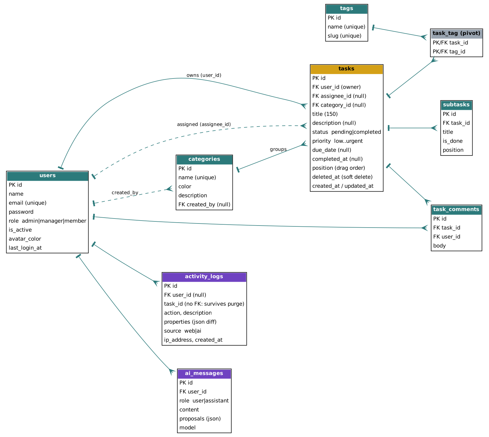

# Database design

MySQL 8 / MariaDB (XAMPP), engine InnoDB, charset `utf8mb4`. Everything is created by migrations in `database/migrations`; run `php artisan migrate --seed`.

## Tables

### `users`
| Column | Type | Notes |
|---|---|---|
| id | bigint PK | |
| name | varchar(255) | |
| email | varchar(255) unique | |
| password | varchar(255) | bcrypt (Eloquent `hashed` cast) |
| role | varchar(20), indexed | `admin` \| `manager` \| `member` (default `member`), cast to `UserRole` enum |
| is_active | boolean | deactivated users are signed out on their next request |
| avatar_color | varchar(7) | UI only |
| last_login_at | timestamp null | |
| remember_token, email_verified_at, timestamps | | Laravel defaults |

### `tasks`
| Column | Type | Notes |
|---|---|---|
| id | bigint PK | |
| user_id | FK users, cascade | owner / creator |
| assignee_id | FK users, null on delete | who must do it |
| category_id | FK categories, null on delete | |
| title | varchar(150) | **required** |
| description | text null | optional |
| status | varchar(20) | `pending` \| `completed` (default `pending`) |
| priority | varchar(10) | `low` \| `medium` \| `high` \| `urgent` (default `medium`) |
| due_date | date null | |
| completed_at | timestamp null | set when status becomes completed, cleared when reopened |
| position | int (signed) | drag-and-drop order; new tasks get `min(position) - 1` so they land on top |
| deleted_at | timestamp null | soft delete (trash) |
| created_at, updated_at | timestamps | `created_at` is the "creation date" shown in the list |

Indexes: `(user_id, status)`, `(assignee_id, status)`, `status`, `priority`, `due_date`, `position`, `title`.

### `categories`, `tags`, `task_tag`
Categories: `name` unique, `color`, `description`, `created_by` (FK, null on delete). Tags: `name` and `slug`, both unique. `task_tag` is the many-to-many pivot with a composite primary key `(task_id, tag_id)` and cascading deletes.

### `subtasks`
`task_id` (cascade), `title`, `is_done`, `position`. Powers the checklist and the progress bar.

### `task_comments`
`task_id` (cascade), `user_id` (cascade), `body`.

### `activity_logs` (append-only audit trail)
`user_id` (FK, null on delete), `task_id` (indexed, **deliberately not a foreign key** so the history survives permanent deletion), `action`, `description`, `properties` (JSON before/after diff), `source` (`web` \| `ai`), `ip_address`, `created_at`.

### `ai_messages`
`user_id` (cascade), `role` (`user` \| `assistant`), `content`, `proposals` (JSON action cards), `model`, `created_at`. Gives the assistant its conversation memory.

### Laravel framework tables
`sessions`, `password_reset_tokens`, `cache`, `cache_locks`, `jobs`, `job_batches`, `failed_jobs`, `migrations`.

## Design decisions
- **Enums stored as strings, not MySQL ENUM:** adding a status or role later is a code change, not an `ALTER TABLE`.
- **Soft deletes on tasks only:** they are the data users care about. Comments and subtasks are removed when a task is permanently deleted.
- **`ON DELETE` behaviour is chosen per relation:** deleting a user removes their own tasks (cascade) but only *unassigns* tasks assigned to them (set null); deleting a category leaves its tasks uncategorised.
- **Signed `position`:** lets new tasks go to the top without renumbering every row.
- **Search** uses `LIKE` on indexed/short columns; for a very large dataset a MySQL `FULLTEXT` index would be the next step.
